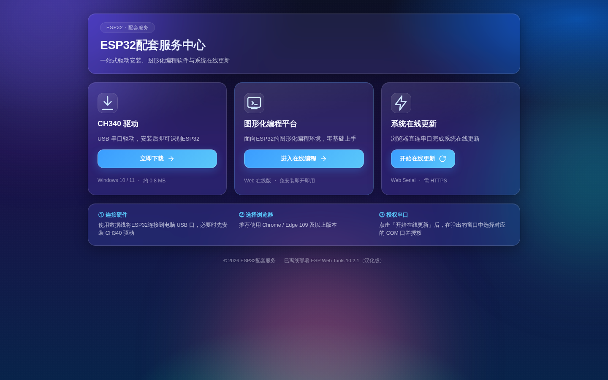

# ⚡ ESP-Web2

> **ESP-Web2** 是专为 ESP32 系列芯片打造的在线固件烧录、驱动中心与配套服务平台。无需在本地安装复杂编译工具链或烧录软件，通过现代浏览器即可一站式完成设备连接、驱动获取与固件在线更新。

---

## 🌐 在线体验

平台已完成 GitHub Pages 云端自动化托管，即开即用：

👉 **[点击直接进入 ESP-Web2 在线服务平台](https://bug423.github.io/esp32-web-tools/)**

---

## 🖼️ 服务中心界面预览

---

## 🛠️ 核心配套服务

- **CH340 驱动下载**：一键获取 USB 串口芯片驱动安装包，快速识别硬件端口。
- **图形化编程平台直达**：无缝链接 OpenBlock Web 在线积木编程环境，即开即用。
- **系统在线更新**：基于 Web Serial API，免本地工具直接在线烧录官方 MicroPython v1.27.0 固件。

---

## 🔌 使用要求

- **推荐浏览器**：现代 Chromium 内核浏览器（Google Chrome 或 Microsoft Edge，版本 89+，支持原生 Web Serial API）。
- **硬件连接**：使用具备数据传输功能的优质 USB 数据线连接 ESP32 开发板。
- **安全上下文**：浏览器安全策略要求在 HTTPS 域名环境或本地 `localhost` 下运行。

---

## 📄 知识产权与开源协议

本项目遵循 **[Creative Commons Attribution-NonCommercial-NoDerivatives 4.0 International (CC BY-NC-ND 4.0)](https://creativecommons.org/licenses/by-nc-nd/4.0/)** 严格非商业开源许可：

- ❌ **严禁商用**：任何个人或组织不得将本项目源码、编译产物或衍生版本用于任何商业盈利目的。
- ❌ **禁止演绎与分发修改版**：未经授权不得散布基于本项目修改后的二次分发版本。
- 🔒 **权利保留**：作者保留对本平台代码与架构的所有版权与法律追责权利。
